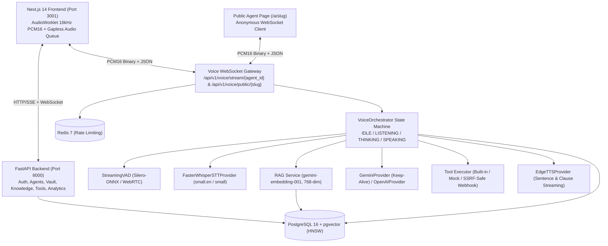
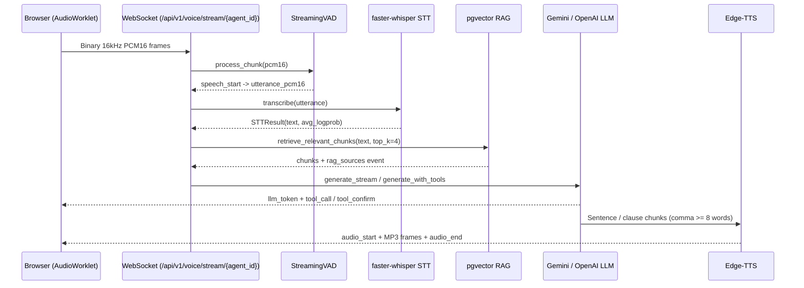
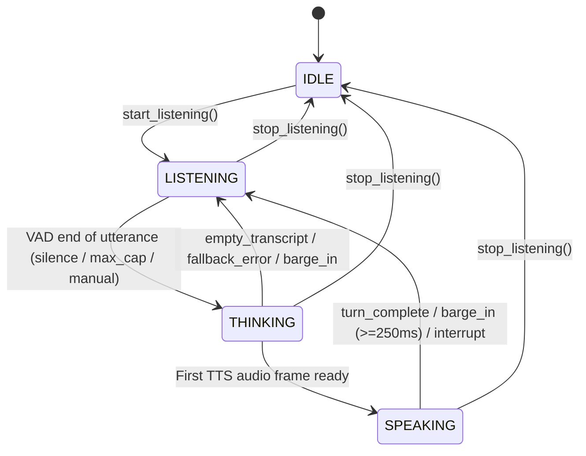

# AI Voice Agent Development & Deployment Platform

An open-source, self-hosted, full-duplex AI Voice Agent studio (Dograh / Vapi / Retell alternative) engineered from first principles without third-party voice-agent wrappers. It implements server-side VAD, local STT, streaming LLM orchestration, sentence/clause-level TTS, pgvector RAG, JSON-schema tool calling with sensitive confirmation gates, public shareable agent pages, and turn-level analytics.

---

## Feature List (Modules A–J)

| Module | Capability | Implementation |
| --- | --- | --- |
| **A. Agent Management** | CRUD, personality, system prompt, model/voice/language/temperature, publish slug | [agents.py](backend/app/api/v1/agents.py), [agent.py](backend/app/models/agent.py) |
| **B. LLM Integration** | Gemini & OpenAI streaming, persistent HTTP keep-alive, rolling context window (`max_turns=6`) | [gemini_provider.py](backend/app/providers/llm/gemini_provider.py), [context_manager.py](backend/app/services/context_manager.py) |
| **C. Speech-to-Text** | Local `faster-whisper` (`small.en`/`small`, CPU `int8`, `beam_size=1`), startup warmup, logprob filtering | [faster_whisper_provider.py](backend/app/providers/stt/faster_whisper_provider.py) |
| **D. Text-to-Speech** | `EdgeTTSProvider` sentence & comma-clause (`>=8` words) streaming MP3, gapless Web Audio queue | [edge_tts_provider.py](backend/app/providers/tts/edge_tts_provider.py), [audioQueue.ts](frontend/src/lib/audioQueue.ts) |
| **E. Real-Time Voice & VAD** | `AudioWorklet` 16kHz PCM16 WebSocket duplex, hysteresis Silero/WebRTC VAD, adaptive RMS gate, 250ms debounced barge-in | [detector.py](backend/app/vad/detector.py), [voice_orchestrator.py](backend/app/services/voice_orchestrator.py) |
| **F. Knowledge Base + RAG** | PDF/TXT/DOCX upload, ~500-token overlap chunking, `gemini-embedding-001` (768-dim), PostgreSQL `pgvector` HNSW cosine search | [rag_service.py](backend/app/services/rag_service.py), [knowledge.py](backend/app/api/v1/knowledge.py) |
| **G. Function Tools** | JSON-schema validation, built-in/mock/SSRF-protected webhook tools, sensitive Confirm/Cancel modal + 30s timeout | [tool_executor.py](backend/app/services/tool_executor.py), [tools.py](backend/app/api/v1/tools.py) |
| **H. Public Deployment** | Unauthenticated `/a/{slug}` voice UI, `/api/v1/voice/public/{slug}`, per-IP Redis rate limits, `user_id=None` | [/a/[slug]/page.tsx](frontend/src/app/a/[slug]/page.tsx), [voice.py](backend/app/api/v1/voice.py) |
| **I. Analytics & Telemetry** | Overview stats, 14-day chart, stage latencies, turn-level error breakdown, filterable session transcripts | [analytics.py](backend/app/api/v1/analytics.py), [analytics/page.tsx](frontend/src/app/dashboard/analytics/page.tsx) |
| **J. Auth & Vault** | JWT auth (`bcrypt`), Fernet AES-256 encrypted API key vault, strict per-user tenant isolation | [security.py](backend/app/core/security.py), [auth.py](backend/app/api/v1/auth.py) |

---

## Architecture

### System Architecture


### Voice Pipeline Sequence


### VoiceOrchestrator State Machine


---

## Tech Stack

| Layer | Choice | Justification |
| --- | --- | --- |
| **Frontend** | Next.js 14 (TypeScript) + Tailwind CSS | App Router, SSR/production build (`next build`), and low-overhead AudioWorklet integration |
| **Backend** | Python 3.12 + FastAPI (async) | Native `asyncio` WebSockets, SSE streaming, and direct ML/audio library ecosystem |
| **ORM & Migrations** | SQLAlchemy 2.0 (async) + Alembic | Typed async ORM with `UniversalVector` supporting pgvector in prod and SQLite in local tests |
| **Database** | PostgreSQL 16 + `pgvector` (HNSW) | Relational multi-tenant state and fast cosine vector search in a single ACID datastore |
| **Cache / Rate Limit** | Redis 7 | Atomic per-user and per-IP sliding-window WebSocket rate limiting with in-memory fallback |
| **VAD** | `silero-onnx` (via `faster-whisper`) + `webrtcvad` | Zero-PyTorch ONNX speech probability scoring with hysteresis and adaptive RMS energy gating |
| **STT** | `faster-whisper` (`small.en` / `small`, CPU `int8`) | Local CTranslate2 inference with zero per-minute STT API cost |
| **LLM** | Google Gemini (`gemini-3.5-flash-lite` + `gemini-3.8-flash` fallback) & OpenAI | Fast SSE streaming, native function calling, and `gemini-embedding-001` (768-dim MRL) |
| **TTS** | `edge-tts` | Free neural streaming MP3 synthesis with sentence/clause pipelining |

---

## Project Structure

```text
AI-PROJECT/
├── backend/
│   ├── alembic/versions/              # PostgreSQL + pgvector migrations (initial, latency, HNSW, tools, errors)
│   ├── app/
│   │   ├── api/v1/                    # auth, agents, chat, voice, knowledge, tools, analytics, health
│   │   ├── core/                      # config, database, logger, security (JWT + Fernet)
│   │   ├── models/                    # user, agent, document, tool, session
│   │   ├── providers/                 # stt/, llm/, tts/, embeddings/
│   │   ├── schemas/                   # Pydantic request/response schemas
│   │   ├── services/                  # voice_orchestrator, rag_service, tool_executor, context_manager, sentence_splitter, rate_limiter
│   │   └── vad/                       # detector.py (StreamingVAD)
│   ├── scripts/                       # eval_rag.py, load_check.py, profile_gemini_stream.py, seed_demo.py
│   ├── tests/                         # pytest integration & unit test suite (44+ tests)
│   ├── Dockerfile
│   └── requirements.txt
├── frontend/
│   ├── public/worklets/               # pcm16-processor.js AudioWorklet
│   ├── src/
│   │   ├── app/                       # /, /login, /register, /a/[slug], /dashboard/*
│   │   ├── lib/                       # api.ts, audioQueue.ts
│   │   └── types/                     # TypeScript interfaces
│   └── Dockerfile                     # Production build (next build + next start) + HEALTHCHECK
├── docs/
│   ├── eval/                          # company_handbook.txt, qa_pairs.json, results.json, results.md
│   ├── ARCHITECTURE.md
│   ├── RND.md
│   └── TESTING_REPORT.md
├── .env.example
└── docker-compose.yml
```

---

## Quick Start (Fresh Clone with Docker)

1. **Clone & configure environment**
   ```bash
   git clone https://github.com/arish-27/ArishS-Q2.git
   cd ArishS-Q2
   cp .env.example .env
   ```
2. **Fill required secrets in `.env`**
   - `JWT_SECRET_KEY`: generate with `openssl rand -hex 32`
   - `ENCRYPTION_SECRET_KEY`: generate with `python -c "from cryptography.fernet import Fernet; print(Fernet.generate_key().decode())"`
   - `GEMINI_API_KEY` (optional if users store keys in the UI Vault, required for `eval_rag.py` / fallback LLM & embeddings)
3. **Build & start all 4 services**
   ```bash
   docker compose up --build -d
   ```
   *(The backend automatically waits for PostgreSQL, runs `alembic upgrade head` idempotently on startup, and starts FastAPI.)*

4. **(Optional) Seed demo data**
   ```bash
   docker compose exec backend python scripts/seed_demo.py
   ```
4. **Access the platform**
   - **Frontend:** http://localhost:3001
   - **Backend Swagger Docs:** http://localhost:8000/docs
   - **Health Check:** http://localhost:8000/api/v1/health

### Demo Seed & Login (`scripts/seed_demo.py`)
```bash
docker compose exec backend python scripts/seed_demo.py
```
- **Email:** `demo@voiceagent.local`
- **Password:** `DemoPass123!`
- Creates published agent `demo-assistant` (`/a/demo-assistant`), assigns `get_current_time` and `get_weather`, and indexes `demo_faq.txt`.

---

## Environment Variables

| Variable | Required | Default / Example | Description |
| --- | --- | --- | --- |
| `JWT_SECRET_KEY` | **Yes** | `openssl rand -hex 32` | HS256 JWT signing secret (>=32 chars, no placeholders) |
| `ENCRYPTION_SECRET_KEY` | **Yes** | Fernet base64 key | Fernet AES-256 key for encrypting user API keys |
| `DATABASE_URL` | **Yes** | `postgresql+asyncpg://...` | Async SQLAlchemy DB URL |
| `REDIS_URL` | **Yes** | `redis://redis:6379/0` | Redis connection URL for rate limiting |
| `GEMINI_API_KEY` | Optional | `""` | Server fallback Gemini key (LLM + `gemini-embedding-001`) |
| `OPENAI_API_KEY` | Optional | `""` | Server fallback OpenAI key |
| `DEFAULT_LLM_PROVIDER` | Optional | `gemini` | Default LLM provider |
| `DEFAULT_GEMINI_MODEL` | Optional | `gemini-3.5-flash-lite` | Primary Gemini model |
| `DEFAULT_GEMINI_FALLBACK_MODEL` | Optional | `gemini-3.8-flash` | Fallback Gemini model on 503/429/timeout |
| `LLM_FIRST_TOKEN_TIMEOUT_S` | Optional | `8` | Voice first-token timeout in seconds |
| `WHISPER_MODEL_SIZE` | Optional | `small` | Non-English `faster-whisper` model size |
| `WHISPER_ENGLISH_MODEL_SIZE` | Optional | `small.en` | English `faster-whisper` model size |
| `WHISPER_BEAM_SIZE` | Optional | `1` | Whisper beam size |
| `WHISPER_CPU_THREADS` | Optional | `0` | `0` auto-detects `os.cpu_count()` |
| `VAD_SILENCE_THRESHOLD_MS` | Optional | `700` | End-of-turn silence threshold (ms) |
| `VAD_SPEECH_START_THRESHOLD` | Optional | `0.6` | VAD hysteresis start threshold |
| `VAD_SPEECH_END_THRESHOLD` | Optional | `0.45` | VAD hysteresis negative/end threshold |
| `VAD_ENERGY_MULTIPLIER` | Optional | `2.0` | Adaptive RMS noise-floor multiplier |
| `VAD_MIN_SPEECH_MS` | Optional | `200` | Minimum confirmed onset speech (ms) |
| `VAD_MAX_UTTERANCE_S` | Optional | `12` | Hard utterance duration cap (seconds) |
| `VAD_BARGE_IN_DEBOUNCE_MS` | Optional | `250` | Confirmed speech ms to trigger barge-in |
| `RAG_EMBEDDING_MODEL` | Optional | `gemini-embedding-001` | Embedding model name |
| `RAG_EMBEDDING_DIM` | Optional | `768` | Output dimensionality (`pgvector(768)`) |
| `RAG_TOP_K` | Optional | `4` | Top chunks retrieved per turn |
| `RAG_SIMILARITY_THRESHOLD` | Optional | `0.35` | Minimum cosine similarity |
| `MAX_UPLOAD_SIZE_MB` | Optional | `10` | Max knowledge file upload size |
| `TOOL_CONFIRM_TIMEOUT_S` | Optional | `30` | Sensitive tool confirmation timeout (seconds) |
| `ALLOW_SENSITIVE_TOOLS_IN_PUBLIC` | Optional | `false` | Allow sensitive tools on `/a/{slug}` |
| `PUBLIC_MAX_SESSIONS_PER_HOUR_PER_IP` | Optional | `20` | Public WebSocket per-IP hourly limit |
| `FRONTEND_PORT` / `NEXT_PUBLIC_API_URL` / `NEXT_PUBLIC_WS_URL` | Optional | `3001` / `http://localhost:8000/api/v1` / `ws://localhost:8000/api/v1/voice/stream` | Frontend port and API/WS endpoints |

---

## How to Use

1. **API Key Vault:** Sign in -> **API Key Vault** -> store your Gemini or OpenAI API key (encrypted with Fernet at rest).
2. **Create Agent:** Go to **Agents -> New Agent**, pick LLM provider/model (`gemini-3.5-flash-lite`), `faster-whisper` language (`en`), and `edge-tts` voice.
3. **Knowledge Base (RAG):** Open **Knowledge Base**, select an agent, drag-and-drop a PDF/TXT/DOCX, wait for `indexed`, and test retrieval in **RAG Query Test**.
4. **Function Tools:** Open **Tools**, add built-in presets or create mock/webhook tools, toggle **Sensitive** if confirmation is required, and assign them to your agent.
5. **Voice Playground:** Open your agent -> **Playground**, click **Start Voice Call**, adjust **Noise Sensitivity** (`Low`/`Medium`/`High`), inspect live transcripts, RAG citations, tool calls, and Confirm/Cancel modals.
6. **Publish & Share:** Toggle **Publish** on the agent settings page and share `/a/{slug}` for anonymous public voice calls.

---

## API Overview

| Method & Path | Auth | Purpose |
| --- | --- | --- |
| `POST /api/v1/auth/register`, `POST /api/v1/auth/login` | Public | User registration & JWT login |
| `GET/POST/DELETE /api/v1/auth/secrets` | JWT | Encrypted API key vault |
| `GET/POST/PUT/DELETE /api/v1/agents`, `POST /api/v1/agents/{id}/publish` | JWT | Agent CRUD & publishing |
| `GET /api/v1/agents/public/{slug}` | Public | Public agent metadata |
| `POST /api/v1/chat/{agent_id}` | JWT | Streaming SSE text chat with RAG & tools |
| `WS /api/v1/voice/stream/{agent_id}` | JWT | Authenticated duplex voice WebSocket |
| `WS /api/v1/voice/public/{slug}` | Public | Anonymous published agent WebSocket |
| `POST /api/v1/knowledge/upload`, `GET /api/v1/knowledge`, `DELETE /api/v1/knowledge/{id}`, `POST /api/v1/knowledge/query-test` | JWT | RAG document ingestion & vector search |
| `GET/POST/PUT/DELETE /api/v1/tools`, `POST/DELETE /api/v1/tools/{id}/assign/{agent_id}` | JWT | Tool CRUD & agent assignment |
| `GET /api/v1/analytics/overview`, `/sessions`, `/sessions/{id}` | JWT | Telemetry, error breakdown & transcripts |

---

## Testing & Performance (Real Measured Numbers)

- **Pytest inside Docker** (`docker compose exec backend pytest --cov=app --cov-report=term-missing`):
  - **`44 passed in 18.34s`**, **`65%` total coverage** (`3255` statements, `1155` missed).
- **RAG Evaluation** (`docker compose exec backend python scripts/eval_rag.py`, saved in [results.json](docs/eval/results.json)):
  - **Retrieval Hit Rate (top-4):** `100.0%` (`20/20`)
  - **Keyword Match Accuracy:** `100.0%`
  - **LLM-as-Judge Avg Score:** `1.000 / 1.0`
  - **Out-of-Knowledge Abstention:** `100.0%` (`5/5`)
  - **Retrieval Latency:** `1199.5 ms` avg / `875.9 ms` p95
  - **LLM TTFT:** `1238.0 ms` avg / `2147.9 ms` p95
- **Load Check** (`docker compose exec backend python scripts/load_check.py`, 10 concurrent text chats):
  - `errors=0`, `wall_ms=1406.3`, `min=524.4 ms`, `avg=745.6 ms`, `p95=1396.3 ms`, `max=1396.3 ms`.

### Voice Pipeline Stage Latency (Container Probes)

| Stage | Before | After | Notes |
| --- | --- | --- | --- |
| **STT (2s speech)** | `~2100 ms` (`5196.8 ms` cold `small`) | **`1699.2 ms`** | `small.en` (`int8`, `beam_size=1`, `cpu_threads=12`) on CPU |
| **LLM TTFT** | `~3500 ms` (`1609.6 ms` cold client) | **`1245.8 ms`** warm (`minimal`) | Persistent keep-alive client; `first_byte == first_token` (network/API bound) |
| **TTS First Audio** | `812.8 ms` | `1203.3 ms` | Edge-TTS network RTT; pre-warmed on WebSocket connect |
| **E2E (Sum of Stage Probes)** | `~6800 ms` | **`~4148 ms`** | CPU Whisper + Gemini API network RTT are the main bottlenecks |

---

## Security

- **Fernet AES-256 Vault:** User LLM keys are encrypted at rest and decrypted server-side per request; never returned in API responses or WebSocket frames.
- **JWT & Tenant Isolation:** All agent, knowledge, tool, chat, and analytics endpoints enforce `user_id` ownership.
- **Rate Limiting:** Redis-backed per-user and per-IP WebSocket connection/hourly limits with in-memory fallback.
- **SSRF Protection:** Webhook URLs block non-`http(s)` schemes, `localhost`, `.local`/`.internal`, and private/loopback/link-local IPs both before and after DNS resolution (`follow_redirects=False`).
- **Sensitive Tool Confirmation:** Sensitive tools emit `tool_confirm`, ask verbally, and abort on Cancel or 30s timeout; excluded from anonymous public sessions by default.

---

## Honest Known Limitations

- **Test DB Isolation:** In Docker, HTTP/WebSocket tests run against PostgreSQL 16 + pgvector, while `test_rag_retrieval_ranking_with_fake_embeddings` uses an isolated in-memory SQLite engine to avoid `asyncpg` cross-loop pool contention.
- **Mock Tools:** Built-in `get_weather`, `book_appointment`, and `send_email` return mock payloads rather than integrating external calendar/SMTP providers.
- **Telephony:** Browser WebSocket audio is implemented; PSTN/SIP telephony (Twilio/LiveKit) is not implemented.
- **CPU STT & Cloud API Latency:** Without a GPU, `faster-whisper` `small.en` takes ~1.7s for 2s audio, and Gemini Free Tier network RTT + 15 RPM limits add ~1.1s–2.1s+ TTFT variance.

---

## Screenshots

| View | File |
| --- | --- |
| Dashboard Overview | `docs/screenshots/dashboard.png` |
| Agent Config | `docs/screenshots/agent-config.png` |
| Voice Playground | `docs/screenshots/playground.png` |
| Knowledge Base (RAG) | `docs/screenshots/knowledge-base.png` |
| Function Tools | `docs/screenshots/tools.png` |
| Analytics & Transcripts | `docs/screenshots/analytics.png` |
| Public Agent Page (`/a/{slug}`) | `docs/screenshots/public-page.png` |

---

## Further Documentation

- [docs/RND.md](docs/RND.md) — Research & Development specification
- [docs/ARCHITECTURE.md](docs/ARCHITECTURE.md) — Mermaid system, sequence, state, and ER diagrams
- [docs/TESTING_REPORT.md](docs/TESTING_REPORT.md) — Full test, coverage, RAG eval, and load test report
