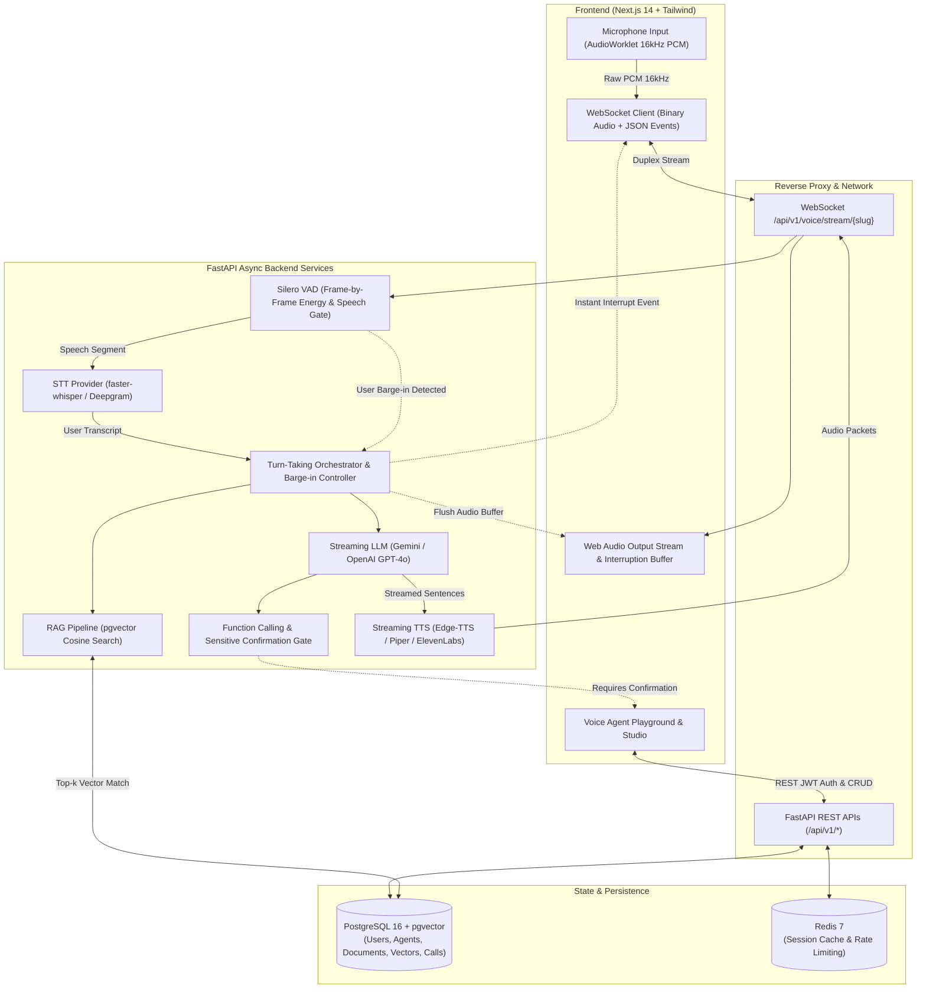

# AI Voice Agent Development & Deployment Platform

An open-source, full-stack, enterprise-grade platform for building, testing, and deploying real-time conversational AI voice agents (like Dograh, Vapi, or Retell AI) — engineered completely from first principles without relying on third-party voice wrappers.

---

## 🏛️ System Architecture



---

## 🚀 Key Features

1. **In-House Real-Time Pipeline**:
   - Zero vendor lock-in. Full control over VAD, STT, LLM context, and TTS chunking.
   - **Local STT**: `faster-whisper` (CTranslate2) with quantization for rapid inference.
   - **TTS Providers**: Free high-fidelity streaming with `edge-tts` and local `piper`, with optional `openai` and `elevenlabs`.
   - **Streaming LLM**: Native integration for Google Gemini and OpenAI with real-time token streaming.
2. **Server-Side VAD & Instant Barge-In**:
   - Low-latency speech detection using Silero VAD.
   - Instant audio stream cancellation (<150ms) when the user interrupts the agent.
3. **Agent Management & Personality Studio**:
   - Configure agent name, personality, system prompt, voice, language, temperature, and provider.
4. **Knowledge Base + RAG Grounding**:
   - Upload PDF, TXT, and DOCX documents.
   - Automatic text extraction, semantic chunking, and embedding in **PostgreSQL `pgvector`**.
   - Agent-specific top-k similarity retrieval injected seamlessly into LLM prompt turns.
5. **JSON-Schema Tool Calling & Sensitive Gate**:
   - Define custom function tools and external HTTP webhooks.
   - Sensitive action gate requires verbal or UI confirmation before executing state-changing tasks (e.g. payments, booking, sending emails).
6. **Testing Playground**:
   - Browser studio with live bidirectional voice conversation, real-time transcript streaming, RAG chunk inspection, tool execution timeline, and per-stage latency breakdown (STT, LLM TTFT, TTS TTFA).
7. **Instant Deployment**:
   - One-click publish to a public, shareable link (`/a/{slug}`) with a clean, mobile-responsive voice interface.
8. **End-to-End Analytics**:
   - Track session history, conversation turns, audio duration, latency metrics, and error rates.

---

## 📦 Project Structure

```text
AI-PROJECT/
├── backend/
│   ├── app/
│   │   ├── api/
│   │   │   ├── v1/
│   │   │   │   ├── auth.py             # User JWT auth & API key secrets vault
│   │   │   │   ├── agents.py           # Agent CRUD & slug management
│   │   │   │   ├── knowledge.py        # Document upload, chunking & RAG queries
│   │   │   │   ├── tools.py            # Function calling & webhook configurations
│   │   │   │   ├── voice.py            # Real-time WebSocket audio stream endpoint
│   │   │   │   ├── sessions.py         # Call session history
│   │   │   │   ├── analytics.py        # Aggregate metrics & charts
│   │   │   │   └── health.py           # Service health checks
│   │   │   └── router.py
│   │   ├── core/
│   │   │   ├── config.py               # Pydantic environment configuration
│   │   │   ├── security.py             # JWT token handling & Fernet key encryption
│   │   │   ├── database.py             # Async SQLAlchemy & pgvector engine
│   │   │   ├── redis.py                # Redis client & rate limiting
│   │   │   └── logger.py               # Structured logger
│   │   ├── models/                     # SQLAlchemy Declarative Models
│   │   ├── schemas/                    # Pydantic DTO validation schemas
│   │   ├── services/                   # Business logic & orchestrators
│   │   ├── providers/                  # Extensible AI Providers
│   │   │   ├── stt/                    # faster-whisper, deepgram
│   │   │   ├── llm/                    # gemini, openai
│   │   │   └── tts/                    # edge-tts, piper, elevenlabs, openai
│   │   ├── vad/                        # Silero VAD & energy gating
│   │   └── main.py                     # FastAPI application bootstrap
│   ├── tests/                          # Pytest automated test suites
│   ├── requirements.txt                # Python backend dependencies
│   └── Dockerfile
├── frontend/
│   ├── src/
│   │   ├── app/
│   │   │   ├── (auth)/                 # Login & Registration pages
│   │   │   ├── dashboard/              # Studio, Agents, Knowledge, Tools, Analytics
│   │   │   │   └── agents/[id]/
│   │   │   │       └── playground/     # Interactive testing playground
│   │   │   ├── a/[slug]/               # Public published voice agent page
│   │   │   ├── layout.tsx
│   │   │   └── page.tsx                # Landing & overview page
│   │   ├── components/                 # Voice visualizers, audio streamer, latency HUD
│   │   ├── lib/                        # API client, Web Audio worklet & WebSocket helpers
│   │   └── types/                      # TypeScript shared interfaces
│   ├── package.json
│   ├── tsconfig.json
│   ├── tailwind.config.js
│   └── Dockerfile
├── docs/
│   ├── RND.md                          # In-depth technical research & design document
│   └── TESTING_REPORT.md               # Continuous test reports and evaluation matrix
├── docker-compose.yml                  # 4-tier containerized stack (Postgres, Redis, API, UI)
├── .env.example                        # Template environment configurations
└── README.md
```

---

## ⚙️ Environment Variables

Copy `.env.example` to `.env` and configure your credentials:

```bash
cp .env.example .env
```

| Variable | Description | Default / Example |
| :--- | :--- | :--- |
| `ENVIRONMENT` | Runtime environment mode | `development` |
| `BACKEND_PORT` | FastAPI backend HTTP & WebSocket port | `8000` |
| `FRONTEND_PORT` | Next.js web application port | `3000` |
| `POSTGRES_USER` | PostgreSQL user | `voiceagent` |
| `POSTGRES_PASSWORD` | PostgreSQL password | `voiceagent_secret` |
| `POSTGRES_DB` | PostgreSQL database name | `voiceagent_db` |
| `DATABASE_URL` | Async PostgreSQL connection string | `postgresql+asyncpg://...` |
| `REDIS_URL` | Redis cache and session URL | `redis://redis:6379/0` |
| `JWT_SECRET_KEY` | Secret key for JWT signing | *(32-byte hex string)* |
| `ENCRYPTION_SECRET_KEY` | Fernet 32-byte base64 encryption key | *(Base64 Fernet key)* |
| `GEMINI_API_KEY` | Google Gemini API key (optional default) | `AIzaSy...` |
| `OPENAI_API_KEY` | OpenAI API key (optional default) | `sk-...` |
| `DEFAULT_LLM_PROVIDER` | Fallback LLM provider | `gemini` |
| `DEFAULT_STT_PROVIDER` | Default Speech-to-Text engine | `faster-whisper` |
| `DEFAULT_TTS_PROVIDER` | Default Text-to-Speech engine | `edge-tts` |
| `DEFAULT_TTS_VOICE` | Default neural voice | `en-US-GuyNeural` |

---

## 🐳 Docker Deployment

The entire stack is configured with health checks and dependencies in `docker-compose.yml`:

```bash
# Build and launch all 4 containers: postgres (with pgvector), redis, backend, frontend
docker compose up -d --build

# Verify container health
docker compose ps

# View service logs
docker compose logs -f backend
```

Access services:
- **Frontend App**: `http://localhost:3000`
- **Backend API & Swagger Docs**: `http://localhost:8000/docs`
- **Health Check**: `http://localhost:8000/api/v1/health`

---

## 🛠️ Local Development (Without Docker)

### Backend Setup:
```bash
# Create and activate Python virtual environment
python -m venv .venv
.\.venv\Scripts\Activate.ps1   # On Windows
# source .venv/bin/activate    # On Linux/macOS

# Install dependencies
pip install -r backend/requirements.txt

# Run automated tests
pytest backend/tests -v

# Start FastAPI development server
uvicorn app.main:app --app-dir backend --reload --port 8000
```

### Frontend Setup:
```bash
cd frontend
npm install
npm run dev
# App starts at http://localhost:3000
```

---

## 🧪 Testing & Verification

Automated test suites can be verified at any time:
```bash
pytest backend/tests -v
```

See [docs/TESTING_REPORT.md](file:///d:/AI-PROJECT/docs/TESTING_REPORT.md) for full phase-by-phase test outputs and benchmark evaluation specifications.
