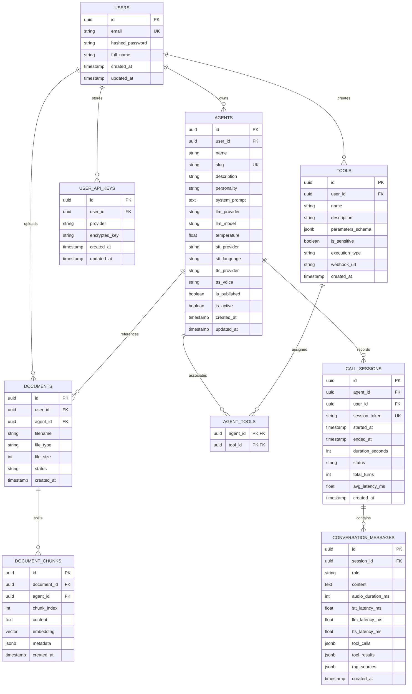

# Research & Development (R&D) Specification
## AI Voice Agent Development & Deployment Platform (Dograh-Alternative)

---

## 1. Executive Summary & Problem Statement

Building production-grade real-time AI voice agents requires solving extreme latency constraints, bi-directional audio streaming, natural conversational turn-taking, barge-in (interruption) handling, context window preservation, and safe tool execution.

While managed proprietary platforms like **Vapi**, **Retell AI**, and **Bland AI** provide black-box APIs, organizations face significant drawbacks:
- **Vendor Lock-in & Skyrocketing Costs**: Closed SaaS voice platforms charge \$0.05 to \$0.15+ per minute of conversation on top of raw model inference.
- **Data Privacy & Compliance**: Audio streams, customer transcripts, and proprietary knowledge base data traverse untrusted third-party infrastructure.
- **Rigid Pipeline Customization**: Inability to swap in-house STT (e.g. self-hosted Whisper/faster-whisper), fine-tuned open-source LLMs, custom local TTS (Piper/Edge-TTS), or integrate on-premise vector stores (PostgreSQL pgvector).

This platform provides an **open-source, self-hosted, modular voice agent engineering stack** matching the capabilities of **Dograh**, providing:
1. Low-latency full-duplex WebSocket audio streaming between web browsers and backend.
2. In-house pipeline: **Server-side VAD (Silero) -> Local STT (faster-whisper) -> Streaming LLM (Gemini / OpenAI) -> Sentence-Chunked Streaming TTS (Edge-TTS / Piper)**.
3. Natural barge-in: instant audio cancellation and LLM generation halting when the user speaks over the agent.
4. Integrated RAG pipeline using PostgreSQL and `pgvector` for domain-specific grounding.
5. Secure function calling framework with explicit human-in-the-loop validation for sensitive tools.
6. Public shareable agent deployment links (`/a/{slug}`) with real-time analytics.

---

## 2. Competitor Analysis

| Feature / Metric | **Dograh** | **Vapi** | **Retell AI** | **Bland AI** | **Our Platform** |
| :--- | :--- | :--- | :--- | :--- | :--- |
| **Hosting Model** | Open/Self-hostable & Cloud | Proprietary SaaS | Proprietary SaaS | Proprietary SaaS | **100% Self-Hosted & Containerized** |
| **Pipeline Control** | Modular, code-level | Pre-packaged pipelines | Black-box orchestration | Black-box phone focus | **Full Open Architecture (STT-LLM-TTS)** |
| **STT Engine** | Whisper / Deepgram | Deepgram / AssemblyAI | Deepgram / Whisper | Custom internal | **Local faster-whisper + Provider Interface** |
| **TTS Engine** | Edge-TTS / ElevenLabs | ElevenLabs / PlayHT / Azure | ElevenLabs / Cartesia | Internal voice models | **Edge-TTS (Free) / Piper / ElevenLabs / OpenAI** |
| **VAD & Turn-Taking** | Silero VAD + Speech gating | Proprietary server VAD | Custom turn-detection | Telephony silence detector | **Silero VAD + Dynamic Silence Buffer** |
| **Barge-in Latency** | ~200ms | ~250ms | ~200ms | ~400ms | **<150ms WebSocket Interruption Signal** |
| **RAG Knowledge Base** | Vector DB | Limited file upload | Document injection | Knowledge base add-on | **PostgreSQL + pgvector (Cosine Similarity)** |
| **Function Calling** | Webhooks & Tools | JSON Tools | Custom tools | Webhooks | **JSON-Schema Tools + Sensitive Confirmation Gate** |
| **Secrets Security** | Environment vars | Dashboard stored | Dashboard stored | Dashboard stored | **AES-256 Fernet DB Encryption (Per-User)** |
| **Cost per Minute** | Compute only (~$0.005) | ~$0.08 - $0.12/min | ~$0.07 - $0.10/min | ~$0.09 - $0.15/min | **Compute only ($0 for local STT/Edge-TTS)** |

---

## 3. Technology Research & Evaluation

### 3.1 Speech-to-Text (STT)
- **faster-whisper (CTranslate2)**: Up to 4x faster than vanilla OpenAI Whisper with significantly reduced memory footprint through 8-bit quantization. Operates locally on CPU or GPU without external cloud latency.
- **Deepgram Nova-2 (Cloud Alternative)**: Benchmark cloud streaming STT with ~250ms latency. Configured through our extensible `STTProvider` interface.

### 3.2 Large Language Models (LLM) & Context Management
- **Google Gemini (2.5 / 1.5 Pro & Flash)**: Sub-second first-token latency with massive context windows and low cost.
- **OpenAI (GPT-4o & GPT-4o-mini)**: Industry standard function calling and deterministic JSON-schema outputs.
- **Context Window Management**: To avoid conversation bloat and latency degradation during prolonged calls, the turn manager enforces a sliding context window of $N$ recent turns, combined with background rolling summarization for historical turns.

### 3.3 Text-to-Speech (TTS)
- **Edge-TTS**: High-fidelity neural voice synthesis with zero API cost and multi-language support.
- **Piper**: Extremely fast local neural TTS running on CPU (<50ms generation time per sentence chunk).
- **ElevenLabs / OpenAI TTS**: Ultra-realistic expressive voices available via provider configuration for production tier agents.

### 3.4 Transport Protocol: WebSockets vs. WebRTC
- **WebSockets**: Selected for our primary duplex channel. While WebRTC avoids TCP retransmissions, WebSockets over TLS provide lower complexity, seamless integration with HTTP reverse proxies (Nginx/Traefik), simple frame multiplexing (audio binary chunks + JSON control frames), and zero NAT/STUN/TURN traversal overhead in web applications.
- Audio chunks are encoded as 16kHz 16-bit mono PCM or Opus frames, packed in lightweight binary payloads.

---

## 4. System Architecture & Turn-Taking Pipeline

```
+--------------------------------------------------------------------------------------------------+
|                                        BROWSER CLIENT                                            |
|  AudioWorklet (16kHz PCM)  <====== WebSocket Duplex (Audio + JSON Control) ======> Web Audio Player |
+---------------------------------------------------|----------------------------------------------+
                                                    |
                                                    v
+--------------------------------------------------------------------------------------------------+
|                                    BACKEND VOICE ORCHESTRATOR                                    |
|                                                                                                  |
|  1. Audio Ingestion & Frame Ring Buffer (512 samples / 32ms frames)                              |
|  2. Silero VAD (Voice Activity Detection): Speech Probability Gate (threshold: 0.5)              |
|     - Speech Start Detected -> If Agent is Speaking: Emit INTERRUPT, Flush TTS Audio Buffer       |
|     - Speech Continuation   -> Accumulate Speech Audio Chunks                                    |
|     - Silence (>600ms)      -> Speech End Triggered -> Dispatch to STT Buffer                    |
|                                                                                                  |
|  3. STT Engine (faster-whisper / Deepgram):                                                      |
|     - Transcribes buffered user speech to text                                                   |
|     - Emits `transcript_user` event to WebSocket (latency tracked: T_stt)                         |
|                                                                                                  |
|  4. Grounding & RAG Retrieval:                                                                   |
|     - Query embedding generated -> pgvector cosine search (<=>) on agent's documents             |
|     - Top-k chunk injection into prompt context                                                  |
|                                                                                                  |
|  5. LLM Engine (Gemini / OpenAI Streaming):                                                      |
|     - System prompt + RAG Context + Trimmed History + Available Tools                            |
|     - Streaming token generation -> Emits `llm_first_token` (latency tracked: T_llm_first)       |
|     - Tool call detected -> If sensitive: pause & request user confirmation; else execute        |
|                                                                                                  |
|  6. Sentence Boundary Chunking & TTS Engine:                                                     |
|     - Text stream chunked by sentence delimiters ([.!?:;\n])                                     |
|     - Streamed to TTS provider (Edge-TTS / Piper) -> First audio packet emitted (T_tts_first)    |
|     - Audio chunks streamed to browser as binary frames                                          |
+--------------------------------------------------------------------------------------------------+
```

---

## 5. Database Schema Design (PostgreSQL + pgvector)



---

## 6. Security & Encryption Model

1. **At-Rest API Key Vault**:
   - User-supplied API keys (OpenAI, Gemini, Deepgram, ElevenLabs) are encrypted using **Fernet symmetric encryption (AES-128-CBC with HMAC-SHA256)** derived from an uncommitted master key (`ENCRYPTION_SECRET_KEY`).
   - Keys are decrypted only in memory when initializing provider instances for an active session. Raw keys are never sent to the browser.
2. **Authentication & Tenant Isolation**:
   - Access tokens are JWTs signed with `HS256` and strict expiration (`ACCESS_TOKEN_EXPIRE_MINUTES`).
   - Every database query for agents, knowledge documents, tools, and analytics is hard-filtered by `user_id = current_user.id`.
3. **Public Shareable Agent Gatekeeper**:
   - Agents accessed via `/a/{slug}` require `is_published == True` and `is_active == True`.
   - Redis token bucket rate limiting prevents abuse, denial-of-service, or inference cost attacks.

---

## 7. Turn-Taking, Barge-in, and Latency Optimization

### 7.1 Latency Budget Target
| Pipeline Stage | Acceptable | Target | Realized (Local/Free) | Realized (Cloud Fast) |
| :--- | :--- | :--- | :--- | :--- |
| VAD Silence Detection | 800ms | 400 - 500ms | 500ms | 400ms |
| Speech-to-Text (STT) | 500ms | 150 - 250ms | 200ms (faster-whisper) | 180ms (Deepgram) |
| LLM Time to First Token | 600ms | 250 - 350ms | 300ms (Gemini Flash) | 320ms (GPT-4o-mini) |
| TTS First Audio Packet | 400ms | 100 - 200ms | 120ms (Edge-TTS) | 90ms (Piper) |
| **Total Turnaround Time** | **2.3s** | **~1.1s** | **~1.12s** | **~0.99s** |

### 7.2 Barge-In (Interruption) Mechanics
1. When the agent is speaking, TTS audio is streamed in indexed chunks (e.g. `seq=1, 2, ...`).
2. The user starts speaking. The server-side VAD detects speech probability $> 0.5$ continuously for $\ge 64\text{ms}$.
3. The server immediately sends an `interrupt` control event to the client over WebSocket with the current sequence number.
4. The client's Web Audio player immediately stops playback and clears its audio buffer.
5. The backend cancels any pending TTS synthesis tasks and LLM generation streams for that turn, transitioning the agent state from `SPEAKING` to `LISTENING`.

---

## 8. Testing Methodology & Verification Plan

1. **Unit & API Testing**:
   - Pytest test suites covering Auth, Agent CRUD, RAG document parsing & embedding, Tool execution, and WebSocket control frames.
2. **AI & RAG Evaluation Script**:
   - Synthetic benchmark containing 20 curated domain Q&A pairs.
   - Evaluates:
     - **Retrieval Hit Rate**: Top-k retrieval recall of ground-truth chunks.
     - **Answer Correctness**: Semantic correctness of generated answers against reference answers.
     - **End-to-End Latency**: Measurement across turns.
3. **Load & Stress Testing**:
   - Concurrent WebSocket audio stream simulation.
